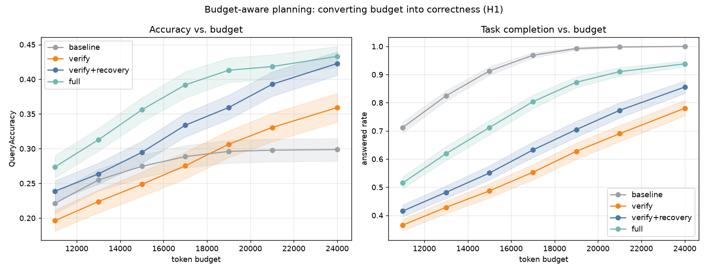
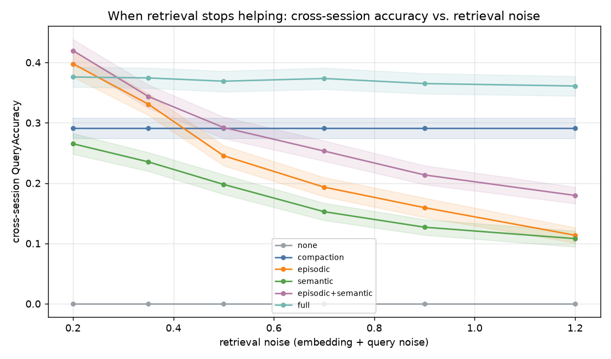
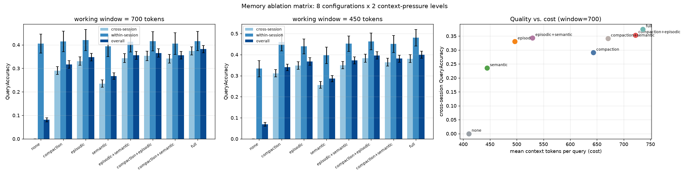
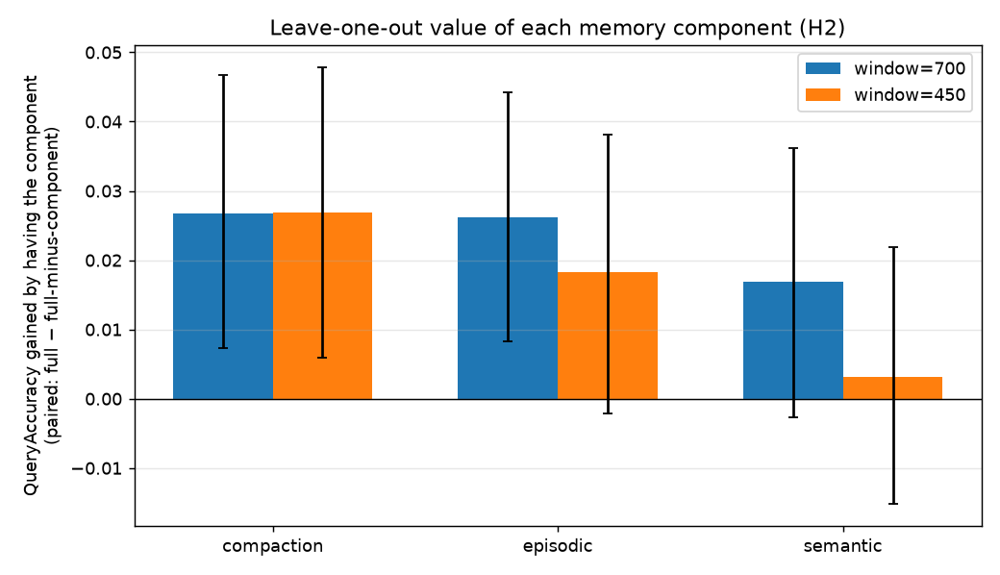
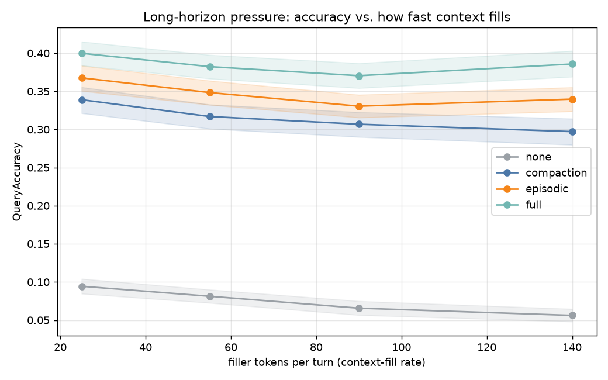
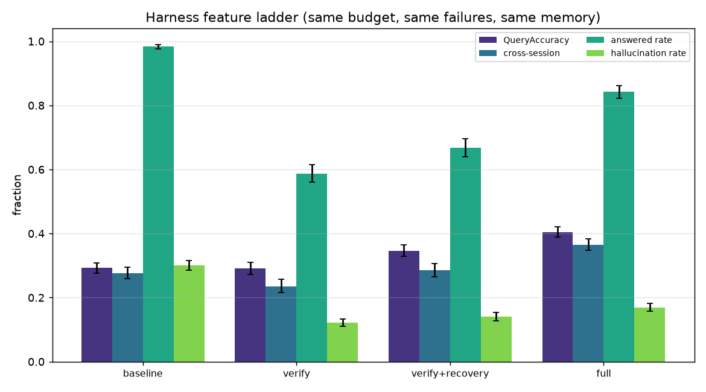
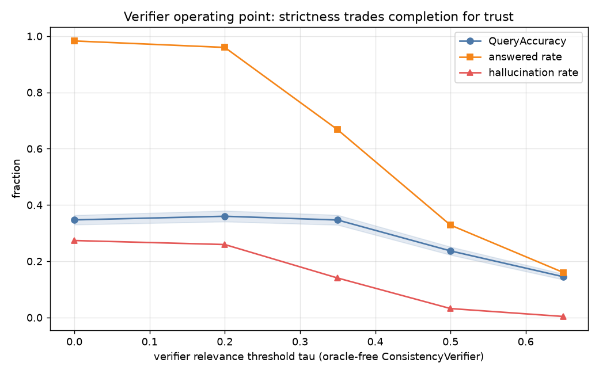
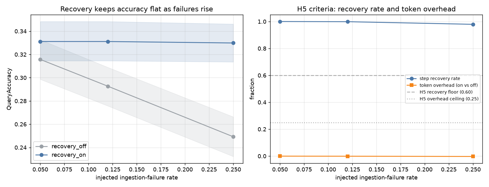

# Results

All numbers come from `make reproduce` with the committed config
(`src/dah/experiments/config.py`): **120 paired seeds per arm** (seed *i* is the
same task in every arm), 95% CIs — percentile bootstrap for levels, **paired
bootstrap with 10,000 resamples for every delta** (R4). The provider's
context-degradation model (`l_half=1200, gamma=1.5, m_mid=0.60`) is identical in
every condition. Full study: ~2 minutes on a laptop, bit-for-bit reproducible;
every CSV row carries `seed` and `config_id` (R3). Verdicts are machine-computed
by `dah-analyze` into `results/hypotheses.csv`.

> Method and threats-to-validity live in [DESIGN.md](DESIGN.md). Absolute levels
> reflect a *model* of context degradation; trust the relative comparisons and
> directions, not the fractions as benchmark scores.

---

## Headline

**1. The harness converts budget into correctness; the baseline cannot.** At the
default binding budget (18k tokens, 12% transient step failures), switching on
the full control plane over the *same* memory and model moves QueryAccuracy
**0.293 → 0.405** (paired delta **+0.112, 95% CI [+0.092, +0.133]**, +38%
relative) while cutting confident-hallucination **0.301 → 0.169** (paired delta
**−0.131 [−0.150, −0.113]**) and eliminating lost ingestions (**6.65 → 0.01 per
task**). As budget grows the naive baseline saturates at ~0.30 while the full
harness keeps climbing to 0.433 at 24k:



**2. A clean negative result on retrieval.** Similarity-based episodic retrieval
is the best single memory component with clean embeddings — and collapses from
**0.398 to 0.114** cross-session accuracy as retrieval noise rises, **falling
below dumb, retrieval-free persistent compaction (flat 0.291) between noise 0.35
and 0.5**. Configurations that pair retrieval with a retrieval-independent
channel (`full`) hold ~0.36–0.38 across the entire noise range.



**3. Verification is a trust knob, not an accuracy knob.** An oracle-free
consistency verifier barely moves top-line accuracy at its best operating point,
but converts confident-wrong answers into abstentions: hallucination falls
monotonically with strictness while answered-rate pays the bill (see
[Verifier operating point](#verifier-operating-point-tau-sweep)).

---

## Hypothesis verdicts

Pre-declared in GOAL.md before the study; machine-computed (with CIs per row) in
`results/hypotheses.csv`.

| ID | Hypothesis (short) | Verdict | Key numbers |
|----|--------------------|---------|-------------|
| H1 | Full harness ≥ +15pp QueryAccuracy over naive at same budget | **Directionally supported; magnitude threshold not met** | Paired delta positive at *every* budget, CI excluding 0 everywhere: +0.052 (11k) → +0.134 (24k); +0.112 at the default 18k. Never reaches the pre-registered +0.15. |
| H2 | Compaction is the highest-value single component at tight windows | **Supported (with overlap caveat)** | Largest leave-one-out drop at both windows: removing compaction costs **0.027 [0.006, 0.048]** (window 450) vs episodic 0.018 [−0.002, 0.038] and semantic 0.003 [−0.015, 0.022]. At window 700 compaction (0.027) and episodic (0.026) are statistically indistinguishable. |
| H3 | Episodic retrieval helps only cross-session and *hurts* within-session | **Partially supported** | Cross-session: **+0.331 [+0.313, +0.349]**. Within-session: **+0.015 [−0.013, +0.046]** — neutral, not negative. The predicted within-session harm does not appear even at high noise (exploratory: −0.006 [−0.027, +0.017] at noise 0.5). |
| H4 | Semantic memory's value flips sign as embedding noise grows | **Refuted — opposite direction** | Marginal value of adding semantic to episodic *grows* with noise: +0.022 [−0.003, +0.048] (n.s.) at noise 0.2 → **+0.066 [+0.052, +0.079]** at 1.2. No crossover exists; salience-gated memory is a noise *hedge*, not a fair-weather friend. |
| H5 | Rollback+retry recovers ≥60% of injected failures at ≤25% token overhead | **Supported, with margin** | Step-level recovery **98–100%** at ~**0% token overhead** across fault rates 0.05–0.25; QueryAccuracy delta grows with fault rate: +0.015 [+0.001, +0.031] → **+0.081 [+0.061, +0.100]**. (The frozen episode-level RecoveryRate is degenerate here — see What didn't work.) |

---

## Ablation matrix

8 memory configurations × 2 context-pressure levels (working window 700 / 450
tokens) × 120 paired tasks. Harness held fixed: no failures, unbounded budget,
static plan, no verifier — memory is the only variable.

**Window = 700 (default pressure).** QueryAccuracy / cross-session / mean context tokens:

| memory | overall | cross-session | within-session | ctx tokens |
|---|---:|---:|---:|---:|
| none | 0.081 | **0.000** | 0.405 | 410 |
| semantic | 0.268 | 0.235 | 0.394 | 444 |
| compaction | 0.317 | 0.291 | 0.415 | 643 |
| episodic | 0.348 | 0.331 | 0.420 | 496 |
| episodic+semantic | 0.356 | 0.344 | 0.413 | 529 |
| compaction+semantic | 0.356 | 0.341 | 0.405 | 671 |
| compaction+episodic | 0.365 | 0.353 | 0.416 | 722 |
| full | **0.382** | **0.374** | 0.416 | 736 |

**Window = 450 (tight).** Same ordering, higher stakes — and an interesting
inversion: every memory-equipped config *gains* accuracy at the tighter window
(e.g. full 0.382 → 0.399, episodic 0.348 → 0.368) because a smaller working set
is a shorter, less-diluted context; only `none` gets worse (0.081 → 0.069). Under
this degradation model, **carrying less raw history is often free or better —
if you have somewhere durable to put it.**



Reading the matrix:

1. **Cross-session recall is the whole game.** `none` scores exactly 0.000
   cross-session (working context resets between sessions; nothing else exists).
   The spread between memory configs is almost entirely cross-session.
2. **Episodic retrieval is the value pick** (0.331 cross at 496 tokens/query —
   top-left of the quality/cost frontier). Adding stores on top buys ~+0.02–0.04
   accuracy for +200 tokens/query.
3. **Leave-one-out (H2):** removing compaction from `full` costs the most at
   both windows — its persisted summary is the only cross-session channel that
   doesn't depend on embeddings. But the margins over episodic are small and
   overlap at window 700; the honest claim is "compaction and episodic carry
   comparable, complementary weight; semantic adds the least."



### Retrieval-noise sweep (H4 and the negative result)

Cross-session QueryAccuracy as embedding+query noise grows:

| memory | 0.2 | 0.35 | 0.5 | 0.7 | 0.9 | 1.2 |
|---|---:|---:|---:|---:|---:|---:|
| none | 0.000 | 0.000 | 0.000 | 0.000 | 0.000 | 0.000 |
| compaction | 0.291 | 0.291 | 0.291 | 0.291 | 0.291 | 0.291 |
| episodic | **0.398** | 0.331 | 0.245 | 0.193 | 0.159 | 0.114 |
| episodic+semantic | 0.420 | 0.344 | 0.292 | 0.253 | 0.214 | 0.180 |
| semantic | 0.265 | 0.235 | 0.198 | 0.153 | 0.127 | 0.108 |
| full | 0.376 | 0.374 | 0.369 | 0.373 | 0.365 | **0.361** |

The mechanism of episodic's collapse is not mysterious: noisy queries retrieve
plausible same-topic neighbours instead of the needed fact, and those
distractors inflate the context, dragging down the accessibility of everything —
including the facts it *did* retrieve. Compaction never touches an embedding, so
it is flat by construction, and `full` inherits that immunity.

H4's prediction was that semantic's *value* would flip sign with noise. The
opposite happened: the salience-gated store contains ~3× fewer items, so under
noisy retrieval it serves fewer distractors, and its marginal value over
episodic grows monotonically with noise (see verdict table). Useful design
consequence either way: **store less, on purpose, if your retrieval is noisy.**

### Context-fill sweep



All configs decay as filler tokens per turn grow; retrieval-based configs decay
most gracefully (they inject a small, targeted context rather than carrying raw
history); `none` collapses toward zero.

### Robustness re-run (T4.2): harder task distributions

The headline memory ordering re-checked on two harder distributions, 120 paired
seeds each (`results/ablation_robustness.csv`):

| setting | none | compaction | episodic | full |
|---|---:|---:|---:|---:|
| default (6 sessions, p_cross=0.55) | 0.081 | 0.317 | 0.348 | **0.382** |
| longer-horizon (10 sessions) | 0.052 | 0.263 | 0.307 | **0.324** |
| cross-heavy (p_cross=0.85) | 0.068 | 0.316 | 0.344 | **0.392** |

The ordering `none < compaction < episodic < full` survives both settings — no
sign flips. Two honest caveats from the longer horizon: (1) everything degrades
(queries reach further back in time), and (2) **the persisted compacted summary
gets expensive as sessions accumulate** — compaction's mean context grows 643 →
813 tokens and `full`'s to 922 at 10 sessions, while episodic stays flat at
~496. Consequently `full`'s margin over plain episodic *narrows* (+0.034 →
+0.017) as the horizon stretches: an unbounded persisted summary is not free,
and a longer-horizon deployment would want summary compaction-of-the-summary or
an age-out policy.

---

## Harness value (feature ladder)

Memory fixed (`episodic`, k=8), budget fixed (18k, binding), fault rate 0.12,
verifier tau=0.35. Features switched on cumulatively; per-arm details:

| condition | QueryAccuracy | cross-session | answered | hallucination | lost ingestions | rollbacks |
|---|---:|---:|---:|---:|---:|---:|
| baseline | 0.293 | 0.277 | 0.984 | 0.301 | 6.65 | 0 |
| +verify | 0.291 | 0.236 | 0.587 | 0.122 | 5.88 | 0 |
| +verify+recovery | 0.347 | 0.285 | 0.667 | 0.140 | 0.01 | 6.71 |
| **full** (+budget-aware) | **0.405** | **0.365** | 0.843 | 0.169 | 0.01 | 7.27 |



The features do *different jobs*:

- **Verification alone** trades completion for trust: hallucination 0.301 →
  0.122 (−59%) while answered-rate drops to 0.59 and accuracy stays flat. Its
  retries also burn budget the static planner never recovers.
- **Checkpoint/rollback + ingestion retry** is the state-integrity feature:
  lost ingestions 5.88 → 0.01, accuracy +0.056 over verify-only.
- **Budget-aware planning** is the completion feature: allocating the remaining
  budget across remaining queries (plus focused, capped retries) lifts
  answered-rate 0.667 → 0.843 and accuracy 0.347 → 0.405 — and it is what makes
  the whole stack scale with budget instead of saturating.

### Verifier operating point (tau sweep)

Oracle-free `ConsistencyVerifier` strictness, on the verify+recovery arm:

| tau | QueryAccuracy | answered | hallucination |
|---:|---:|---:|---:|
| 0.00 | 0.347 | 0.983 | 0.274 |
| 0.20 | **0.360** | 0.960 | 0.259 |
| 0.35 | 0.347 | 0.667 | 0.140 |
| 0.50 | 0.237 | 0.329 | 0.032 |
| 0.65 | 0.145 | 0.160 | 0.004 |



Strictness buys trust (hallucination 0.274 → 0.004) and pays in completion
(0.983 → 0.160). Accuracy peaks at a mild tau=0.2 and *degrades* beyond
tau≈0.35 as false rejections abstain away correct answers. Pick the operating
point from your cost of a confident error — and note the ladder above runs at
tau=0.35, i.e. the headline does **not** cherry-pick the accuracy-optimal
verifier.

---

## Failure recovery

Isolated H5 study: static planner, no verifier, recovery on/off as the only
difference, fault rates 0.05 / 0.12 / 0.25, 120 paired tasks per cell.

| fault rate | step recovery | token overhead | QueryAccuracy on/off | paired delta |
|---:|---:|---:|---:|---:|
| 0.05 | 100.0% | −0.0% | 0.331 / 0.316 | +0.015 [+0.001, +0.031] |
| 0.12 | 99.9% | −0.1% | 0.331 / 0.293 | +0.038 [+0.020, +0.057] |
| 0.25 | 97.9% | −0.3% | 0.330 / 0.249 | +0.081 [+0.061, +0.100] |



Rollback+retry keeps accuracy *flat* as the environment gets flakier, while the
unprotected baseline decays linearly with the fault rate. The token overhead is
approximately zero: an ingest retry costs 6 tokens against ~16k-token episodes.
The H5 criteria (≥60% recovery at ≤25% overhead) are met with an order of
magnitude to spare — in this environment the honest summary is that **ingestion
recovery is nearly free and you should always run it.** The interesting cost of
recovery lives elsewhere (verification retries at query time, which do burn
budget — see the ladder).

---

## What didn't work

Reported with the same rigor as the wins (R3). Each item names the evidence.

1. **H1's pre-registered magnitude was not met.** We predicted ≥ +15pp; we
   measured +5.2pp to +13.4pp depending on budget (CI excludes zero at every
   point, so the *direction* is solid). The +15pp bar was set before the
   baseline's memory was fixed at `episodic` — a strong baseline. Against a
   naive `none`-memory agent the gap would dwarf +15pp, but that comparison
   would conflate memory with control-plane value, so we report the honest
   paired number and call H1 directional. (`results/hypotheses.csv`, H1 rows.)
2. **H4 was refuted — in the opposite direction.** Semantic consolidation was
   supposed to lose value as embeddings got noisy; instead its marginal value
   grows with noise (+0.013 n.s. at 0.35 → +0.066 significant at 1.2) because a
   smaller salience-gated store serves fewer distractors exactly when
   distractors are the problem. (`results/hypotheses.csv`, H4 rows.)
3. **The predicted within-session *harm* from retrieval never materialised.**
   H3's second half claimed distractors would drag within-session accuracy
   below the no-retrieval baseline; measured effect is +0.015 [−0.013, +0.046]
   at default noise and statistically zero at high noise. Dilution is real but
   it hurts by *displacing other retrieved facts*, not by poisoning local
   recall. (`results/hypotheses.csv`, H3 rows.)
4. **Retrieval-only memory is fragile enough to be the wrong default.** The
   headline negative result: episodic-only drops below flat compaction at noise
   ≈0.4–0.5 and keeps falling to 0.114. If you cannot vouch for embedding
   quality on your domain, a persisted compacted summary is the safer core, with
   retrieval layered on top. (`results/ablation_noise.csv`.)
5. **Strict verification without a good signal destroys usefulness.** Above
   tau≈0.5 the oracle-free verifier rejects most correct answers: accuracy
   0.145, answered 0.16 at tau=0.65. Verification-with-abstention is only as
   good as its signal, and "more verification" is not monotonically better.
   (`results/verifier_tau_sweep.csv`.)
6. **The frozen episode-level RecoveryRate metric is degenerate on this suite.**
   As defined (episodes with ≥1 injected failure that still reach
   EpisodeSuccess = QueryAccuracy ≥ 0.8), it reads 0.000 everywhere — not
   because recovery fails but because *no* episode reaches 0.8 accuracy under
   this degradation model, faults or not. We report it as defined
   (`results/hypotheses.csv`) and use the step-level recovery rate as the
   informative measure; re-freezing the metric would need a GOAL.md amendment.
7. **(Exploratory) Context packing order mattered as much as any memory
   component.** An earlier iteration trimmed *retrieved* items first when the
   context cap bound, which silently crippled retrieval under tight budgets
   (full harness gained only +0.03 over baseline). Trimming stale working turns
   first (keeping summary + retrieved) roughly tripled the harness's headline
   delta. All committed results use the corrected policy for every arm; the
   lesson stands on its own: **how you evict is as load-bearing as what you
   store.** (See `docs/JOURNAL.md` entry 2026-07-01.)

---

## Reproduce

```bash
make install        # venv + editable install + dev extras
make test           # 70 tests: unit + governance + reproducibility
make reproduce      # regenerates every CSV/figure/verdict in results/ (~2 min)
python scripts/quality_gate.py --strict   # the whole-repo health check
```

`dah-ablation`, `dah-baseline`, and `dah-analyze` are the same three steps as
console scripts. Every number in this document traces to a CSV in `results/`
with `seed` and `config_id` columns; re-running from a clean checkout reproduces
them bit-for-bit.
