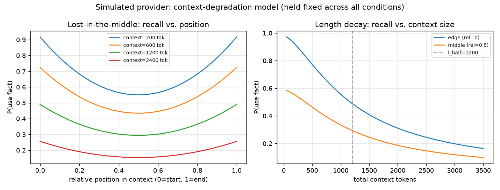
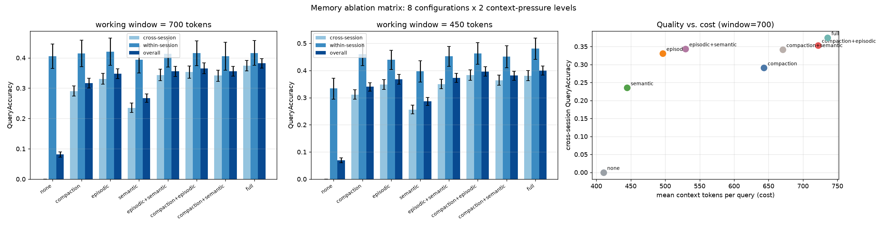
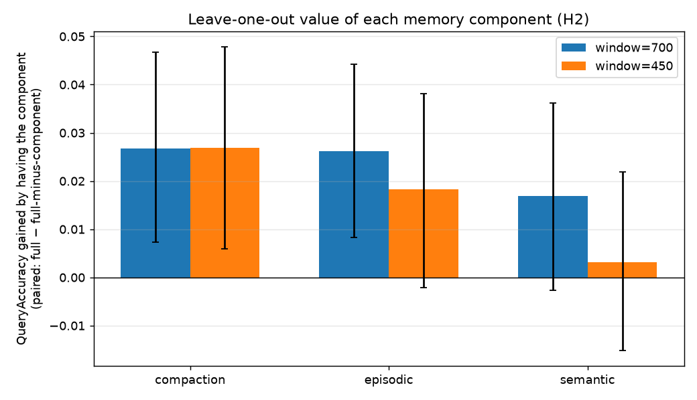
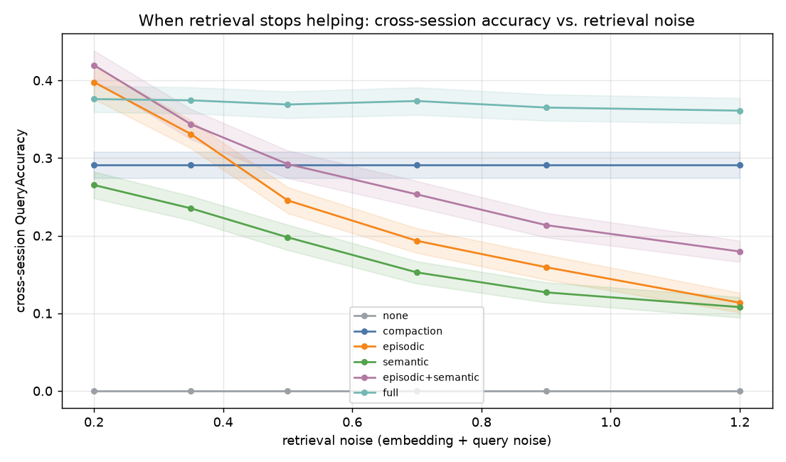
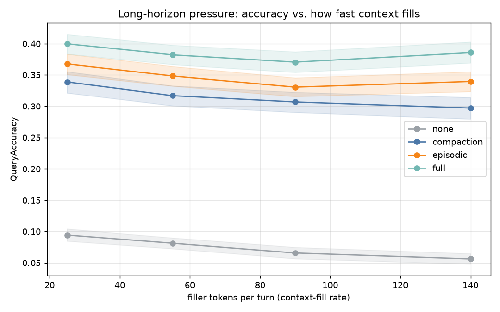
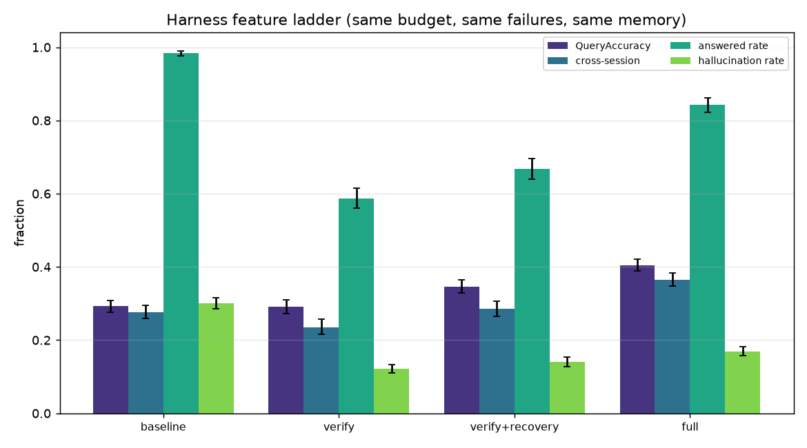
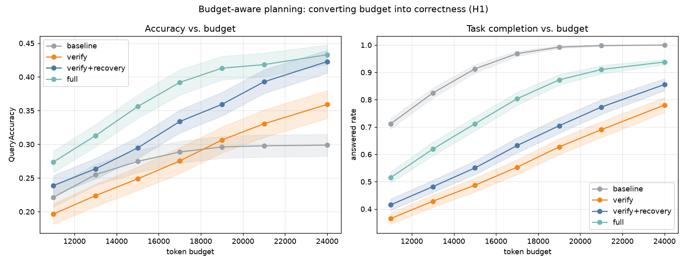
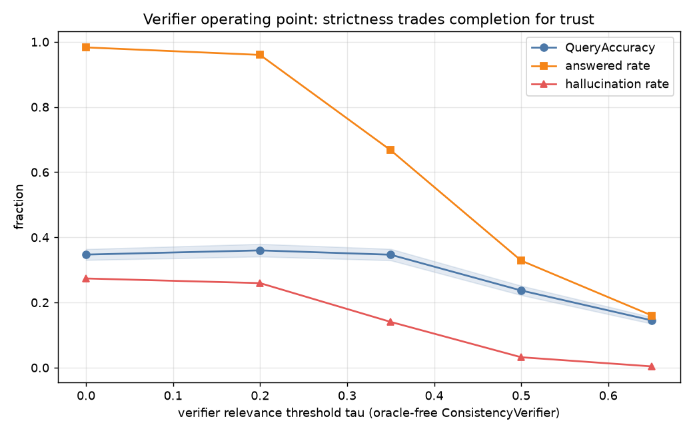
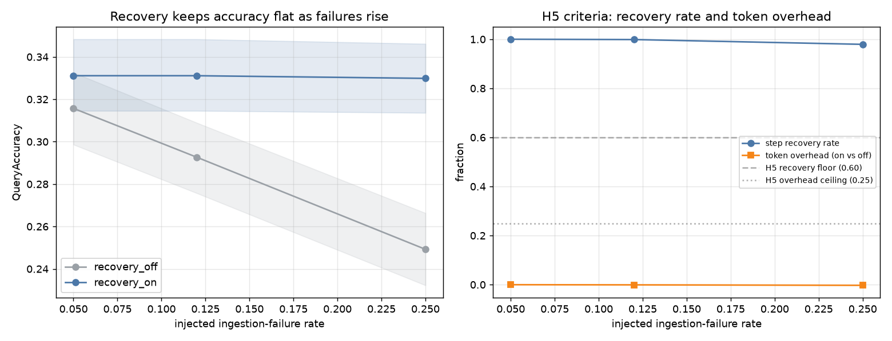

# Generated results summary

## Provider model

## Ablation matrix (window=700)

| condition           |   n |   query_accuracy |   query_accuracy_cross |   query_accuracy_within |   mean_ctx_tokens |
|:--------------------|----:|-----------------:|-----------------------:|------------------------:|------------------:|
| none                | 120 |            0.081 |                  0     |                   0.405 |           410.289 |
| compaction          | 120 |            0.317 |                  0.291 |                   0.415 |           643.326 |
| episodic            | 120 |            0.348 |                  0.331 |                   0.42  |           496.285 |
| semantic            | 120 |            0.268 |                  0.235 |                   0.394 |           444.476 |
| episodic+semantic   | 120 |            0.356 |                  0.344 |                   0.413 |           529.406 |
| compaction+episodic | 120 |            0.365 |                  0.353 |                   0.416 |           721.906 |
| compaction+semantic | 120 |            0.356 |                  0.341 |                   0.405 |           670.543 |
| full                | 120 |            0.382 |                  0.374 |                   0.416 |           735.856 |

## Ablation matrix (window=450)

| condition           |   n |   query_accuracy |   query_accuracy_cross |   query_accuracy_within |   mean_ctx_tokens |
|:--------------------|----:|-----------------:|-----------------------:|------------------------:|------------------:|
| none                | 120 |            0.069 |                  0     |                   0.335 |           307.156 |
| compaction          | 120 |            0.34  |                  0.312 |                   0.46  |           551.248 |
| episodic            | 120 |            0.368 |                  0.348 |                   0.439 |           398.511 |
| semantic            | 120 |            0.286 |                  0.256 |                   0.397 |           343.029 |
| episodic+semantic   | 120 |            0.373 |                  0.35  |                   0.453 |           431.518 |
| compaction+episodic | 120 |            0.396 |                  0.383 |                   0.463 |           632.28  |
| compaction+semantic | 120 |            0.381 |                  0.364 |                   0.451 |           579.351 |
| full                | 120 |            0.399 |                  0.381 |                   0.48  |           647.091 |

## Retrieval-noise sweep

## Context-fill sweep

## Robustness re-run (T4.2): longer-horizon

| condition   |   n |   query_accuracy |   query_accuracy_cross |   query_accuracy_within |
|:------------|----:|-----------------:|-----------------------:|------------------------:|
| none        | 120 |            0.052 |                  0     |                   0.406 |
| compaction  | 120 |            0.263 |                  0.241 |                   0.415 |
| episodic    | 120 |            0.307 |                  0.29  |                   0.422 |
| full        | 120 |            0.324 |                  0.311 |                   0.419 |

## Robustness re-run (T4.2): cross-heavy

| condition   |   n |   query_accuracy |   query_accuracy_cross |   query_accuracy_within |
|:------------|----:|-----------------:|-----------------------:|------------------------:|
| none        | 120 |            0.068 |                  0     |                   0.395 |
| compaction  | 120 |            0.316 |                  0.295 |                   0.405 |
| episodic    | 120 |            0.344 |                  0.33  |                   0.421 |
| full        | 120 |            0.392 |                  0.387 |                   0.42  |

## Harness feature ladder

| condition       |   n |   query_accuracy |   query_accuracy_cross |   answered_rate |   hallucination_rate |
|:----------------|----:|-----------------:|-----------------------:|----------------:|---------------------:|
| baseline        | 120 |            0.293 |                  0.277 |           0.984 |                0.301 |
| verify          | 120 |            0.291 |                  0.236 |           0.587 |                0.122 |
| verify+recovery | 120 |            0.347 |                  0.285 |           0.667 |                0.14  |
| full            | 120 |            0.405 |                  0.365 |           0.843 |                0.169 |

## Budget sweep

## Verifier operating point

## Failure recovery

## Hypothesis verdicts

See `hypotheses.csv` for every row with CIs.
